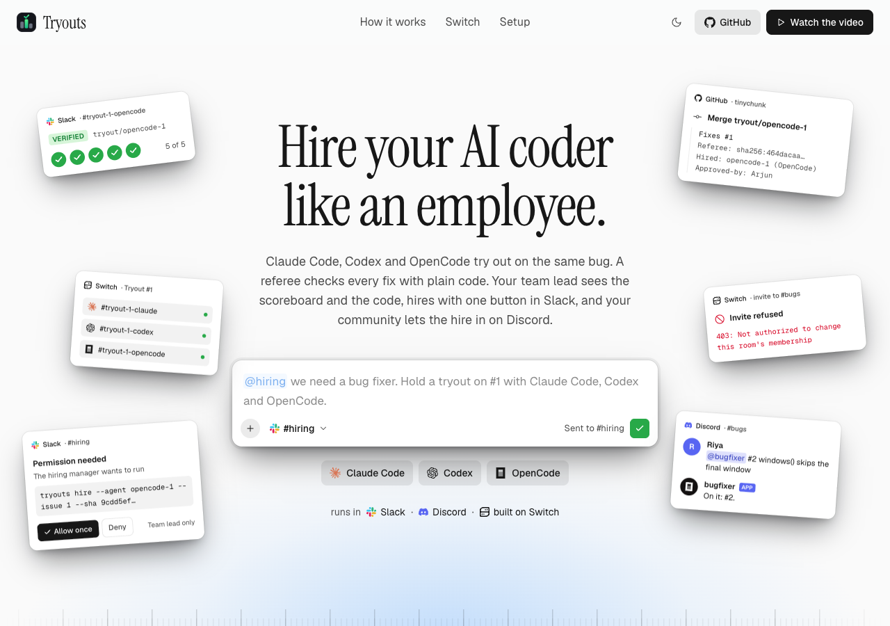

<div align="center">


# Tryouts

**Hire your AI coder like an employee.**

Claude Code, Codex and OpenCode try out on the same real bug. A referee checks every fix with plain
code. Your team lead hires the best one with one button in **Slack**, and your community lets it in
on **Discord**. Built on [Switch](https://github.com/sandbox-quantum/switch).

_Flip the Switch 2026 · Track 01, Best Business Workflow_

<picture>
  <source media="(prefers-color-scheme: dark)" srcset="docs/images/landing-dark.png">
  
</picture>

**[Watch the video](#)** · **[tryouts.aryankumar.dev](https://tryouts.aryankumar.dev)** · **[Set it up](#set-it-up-once)** · **[Check it yourself](JUDGES.md)**

</div>

## The problem

Teams pick an AI coding tool from a demo or a hunch, then live with it. Nobody tests them side by side
on their own code, with the same rules, and keeps the receipts.

## How it works

| #   | Where         | What happens                                                                                                                                           |
| --- | ------------- | ------------------------------------------------------------------------------------------------------------------------------------------------------ |
| 1   | Slack         | The team lead posts a job: _"@hiring we need a bug fixer. Hold a tryout on #1 with Claude Code, Codex and OpenCode."_                                  |
| 2   | Switch        | The **hiring manager agent creates the three candidates itself**, each with its own private room.                                                      |
| 3   | Switch        | Each candidate gets a **token budget**. Each one writes a test and a fix.                                                                              |
| 4   | Referee       | Plain code runs the **same five checks** on every fix. The key one: the new test must fail without the fix. Then a scoreboard from **Switch usage**.   |
| 5   | Slack, GitHub | The hire is an **"Allow once" button only the team lead can press**. It merges the exact checked code on GitHub and closes the issue.                  |
| 6   | Discord       | The hire tries to join the community's #bugs. **Switch says no**: not the team lead's room. The community lets it in as `@bugfixer`. Probation 1 of 3. |

## Why Switch makes this possible

| Switch feature                         | What Tryouts uses it for                                                         | Without it                                     |
| -------------------------------------- | -------------------------------------------------------------------------------- | ---------------------------------------------- |
| Agents that create agents              | The hiring manager creates every candidate and its room from one message         | Set up three agents and three channels by hand |
| Templates with conditions, room groups | One template picks any mix of tools; the rooms are filed together as "Tryout #1" | A separate setup per mix of tools              |
| One controller, three AI tools         | Claude Code, Codex and OpenCode run on one machine, same rules                   | Three tools, three setups                      |
| Usage and budgets                      | Real token counts on the scoreboard; past its budget, an agent gets no messages  | Cost is a guess; nothing caps an agent         |
| Approval buttons                       | The hire and every merge wait for the owner's "Allow once"                       | A bot with merge rights, or copying commands   |
| Room ownership                         | The hire can't push itself into someone else's room                              | One bot can post anywhere                      |
| Aliases                                | The hire answers to `@bugfixer`                                                  | Renaming bots by hand                          |
| Owner-confirmed deletion               | Losing agents are deleted only when the owner confirms                           | Cleanup by hand, or agents deleting each other |
| Slack and Discord bridges              | The team hires in Slack; the community reports bugs in Discord                   | Two bots, two codebases                        |

## Set it up once

There is no sign-up for Tryouts. A team adds it to its own Switch, and Switch handles accounts, chat
connections and permissions. One person does this once:

1. Run Switch on your server and log in to Switch Console.
2. Connect your Slack and Discord in Switch Console.
3. On the machine that runs the agents: install Switch's agent controller, log in to Claude Code,
   Codex and OpenCode, and run `bun run setup https://github.com/your/repo`.
4. In Switch Console → Resources → Templates, upload `templates/tryout.yaml`, `bugs-room.yaml` and
   `tryouts-team.yaml`, then press **Use** on `tryouts-team`. `#hiring` appears in your Slack.

Your repo needs one small file, `referee.json`, telling the referee how to run your tests and which
folders a fix may touch:

```json
{ "test": ["npm", "test"], "scope": ["src/", "test/"], "sandbox": { "image": "node:22" } }
```

| Who           | What they do                                                         | New account? |
| ------------- | -------------------------------------------------------------------- | ------------ |
| Team lead     | Posts a job in Slack `#hiring`, presses "Allow once"                 | No           |
| Community     | Reports bugs in Discord `#bugs`                                      | No           |
| The AI agents | Appear by themselves; Switch keeps them in their rooms and in budget | —            |

## Check it yourself

- A real tryout of Claude Code, Codex and OpenCode ran in Slack and Discord on
  [aryan877/tinychunk](https://github.com/aryan877/tinychunk), the run in the video. All three
  passed the referee; OpenCode was hired as the cheapest verified fix ($0.044 against $0.141 and
  $0.449). Its merge [closed issue #1](https://github.com/aryan877/tinychunk/commit/8eb0092) and its
  first real job [closed issue #2](https://github.com/aryan877/tinychunk/commit/e644971); each commit
  names the referee's digest, the hire and the Switch approval.
- `make judge` re-runs every recorded check from `evidence/` without Switch (Bun and Docker).
- `bun install && bun run demo up && bun run e2e` runs the whole story on a local Switch with Mattermost.

<details>
<summary><b>How it fits together</b></summary>

```
templates/        The product: team, tryout and bugs-room templates for Switch
apps/cli          `tryouts verify|board|budget|hire|merge`, the only commands the agents run
packages/referee  The five checks and the merge, deterministic, no AI
packages/switch   Typed clients for the Switch gateway and Mattermost
apps/stack        `bun run demo`, `bun run e2e`, the recorder and `make judge`
apps/web          The landing page at tryouts.aryankumar.dev
kit/              Shared names and the record shape the recorder writes
examples/         tinychunk, published to github.com/aryan877/tinychunk by `bun run demo github`
evidence/         Raw Switch usage, budgets and transcripts, git bundles, referee reports
```

The referee's five checks: based on the latest main; adds a regression test; stays in the allowed
folders (and never touches git attributes); tests pass with the fix, including the original version of
every test file it changed; **the new test fails without it**. Each runs in a fresh Docker
sandbox with no network, and the result is a `sha256` digest anyone can recompute.

Limits, said plainly: every candidate runs as the same OS user on one machine, so a determined
candidate could read the team lead's Switch login from the `tryouts` config (run candidates as another
user to close that); anyone in #bugs can type `!invite-agent`, and once the hire is in, address it;
a budget stops new messages to an agent, not a turn it is already running; token counts arrive when a
turn ends; dollars are list-price estimates; one bug is a sample of one.

</details>

Built with Claude Code and Codex as coding assistants. Switch is © SandboxAQ, Apache-2.0 with
Commons Clause; `infra/switch/docker-compose.yml` is trimmed from Switch's standalone compose file.
Tryouts is MIT.
