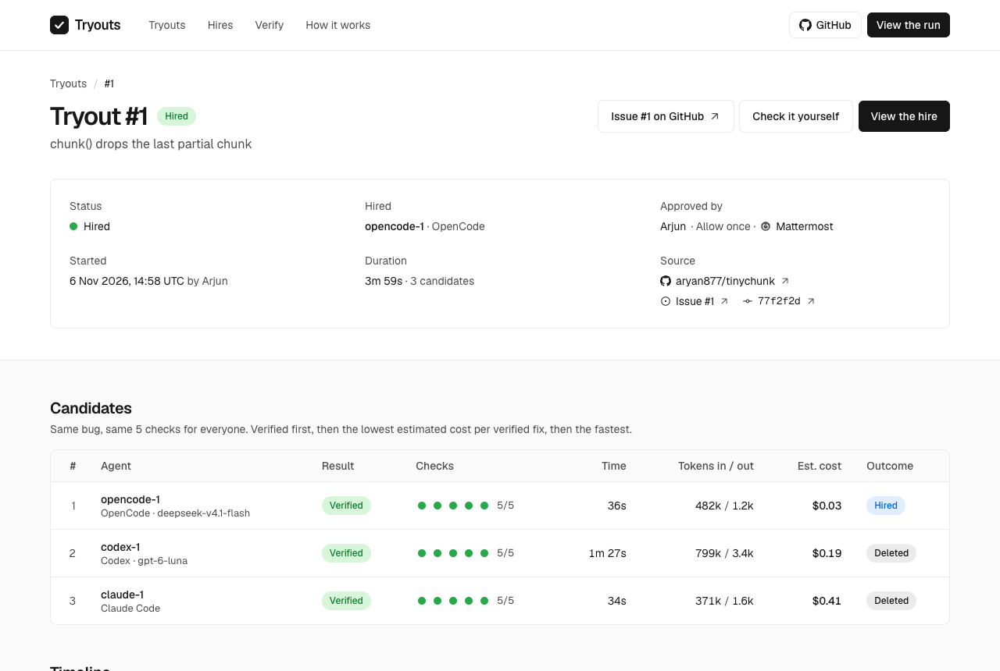

<div align="center">


# Tryouts

**Don't pick your AI coding tool on vibes. Hold tryouts.**

Claude Code, Codex and OpenCode fix the same real bug. A plain-code referee checks every fix. The
team lead hires the best one with one button in **Slack**, and the community's room in **Discord**
has to let the hire in. One [Switch](https://github.com/sandbox-quantum/switch) workflow.

_Flip the Switch 2026 · Track 01, Best Business Workflow_

<picture>
  <source media="(prefers-color-scheme: dark)" srcset="docs/images/run-dark.png">
  
</picture>

**[Watch the 3-minute video](#)** · **[Open the board, no login](#)** · **[Check it yourself](JUDGES.md)**

</div>

## The problem

Teams pick an AI coding tool from a demo or a hunch, then live with it. Nobody runs them side by side
on their own code, with the same rules, and keeps the receipts.

## The real run

On [aryan877/tinychunk](https://github.com/aryan877/tinychunk), a small library with two planted bugs:

| Candidate   | Fixed bug #1 | Referee   | Time | Est. cost | Outcome   |
| ----------- | ------------ | --------- | ---- | --------- | --------- |
| OpenCode    | yes          | 5 of 5 ✅ | 36s  | $0.03     | **Hired** |
| Codex       | yes          | 5 of 5 ✅ | 87s  | $0.19     | Deleted   |
| Claude Code | yes          | 5 of 5 ✅ | 34s  | $0.41     | Deleted   |

All three passed, so the cheapest verified fix won. The hire's merge
[closed issue #1](https://github.com/aryan877/tinychunk/commit/77f2f2d), and its first real job
[closed issue #2](https://github.com/aryan877/tinychunk/commit/27446f3). Each merge commit names the
referee's digest, the hire, and the Switch approval that let it in.

## How a tryout runs

| #   | Where   | What happens                                                                                                                                        |
| --- | ------- | --------------------------------------------------------------------------------------------------------------------------------------------------- |
| 1   | Slack   | Arjun posts in #hiring: _"@hiring we need a bug fixer. Hold a tryout on #1 with Claude Code, Codex and OpenCode."_                                  |
| 2   | Slack   | The **hiring manager agent runs a Switch template itself**: three candidate agents and three private rooms appear, grouped as "Tryout #1".          |
| 3   | Slack   | The referee sets a **Switch budget** per candidate. Each one writes a failing test and a fix.                                                       |
| 4   | Slack   | The referee runs the same **five plain-code checks** on every fix and posts a scoreboard with token counts from **Switch usage**.                   |
| 5   | Slack   | The hire is an **approval button only Arjun can press**. "Allow once" merges the exact checked commit on GitHub and closes the issue.               |
| 6   | Discord | The hiring manager tries to add the hire to the community's #bugs. **Switch refuses**: Arjun doesn't own that room. Riya lets it in as `@bugfixer`. |
| 7   | Slack   | The losers are **deleted only when Arjun confirms**.                                                                                                |
| 8   | Discord | Riya reports bug #2 to `@bugfixer`. The hire fixes it, the referee checks it, Arjun approves: **probation 1 of 3**.                                 |

## What Switch does here, and what breaks without it

| Switch feature                                             | In Tryouts                                                                | Without Switch                                                      |
| ---------------------------------------------------------- | ------------------------------------------------------------------------- | ------------------------------------------------------------------- |
| Agents run templates (`run_template`, `can_manage_agents`) | The hiring manager creates every candidate and its room from one job post | Someone sets up three agents and three channels by hand, per tryout |
| Template v2: `if:`, room groups, links                     | One template, any mix of vendors, filed as "Tryout #1"                    | One script per vendor mix                                           |
| Agent controller, three providers                          | Claude Code, Codex and OpenCode on one machine, same rules                | Three CLIs, three setups                                            |
| Usage and budgets                                          | Real token counts on the board; Switch stops a candidate past its budget  | Cost is a guess; nothing stops a runaway agent                      |
| Approval buttons                                           | The hire and every merge wait on the owner's click                        | A bot with merge rights, or a person copying commands               |
| Room ownership and addressing                              | The hire can't push itself into #bugs; a person there lets it in          | One bot token can post anywhere                                     |
| Aliases, owner-confirmed deletion                          | `@bugfixer` follows the hire; losers vanish only on the owner's confirm   | Renaming bots and cleaning up by hand                               |
| Slack and Discord bridges                                  | The team hires in Slack; the community files bugs in Discord              | Two bots, two codebases                                             |

## Try it

- **Look:** the board, no login: [live link](#). Every number is Switch's own data, recorded in
  `evidence/`. The recorded run used a local Switch with Mattermost standing in for Slack and Discord.
- **Check:** `make judge` replays every verdict and merge from `evidence/` without Switch (Bun and Docker).
- **Run:** `bun install && bun run demo up && bun run e2e` runs the whole story on a local Switch with Mattermost.
- **Adopt:** `bun run setup <your repo>`, then upload the three files in [`templates/`](templates) in
  Switch Console (Resources → Templates).

<details>
<summary><b>How it fits together</b></summary>

```
templates/        The artefact: team, tryout and bugs-room templates for Switch
apps/cli          `tryouts verify|board|budget|hire|merge`, the only commands the agents run
packages/referee  The five checks and the merge, deterministic, no AI
packages/switch   Typed clients for the Switch gateway and Mattermost
apps/stack        `bun run demo`, `bun run e2e`, the recorder and `make judge`
apps/web          The board: Next.js and Geist, rendered from recorded Switch data
kit/              Shared names and the record shape the board reads
examples/         tinychunk, published to github.com/aryan877/tinychunk by `bun run demo github`
evidence/         Raw Switch usage, budgets and transcripts, git bundles, referee reports
```

The referee's five checks: based on the latest main; adds a regression test; stays in `src/` and
`test/`; tests pass with the fix; **the new test fails without it**. Each runs in a fresh Docker
sandbox with no network, and the result is a `sha256` digest anyone can recompute.

Limits, said plainly: every candidate runs as the same OS user on one machine; anyone in #bugs can
type `!invite-agent`; usage is counted when a turn ends; dollars are list-price estimates; one bug is
a sample of one.

</details>

Built with Claude Code and Codex as coding assistants. Switch is © SandboxAQ, Apache-2.0 with
Commons Clause; `infra/switch/docker-compose.yml` is trimmed from Switch's standalone compose file.
Tryouts is MIT.
