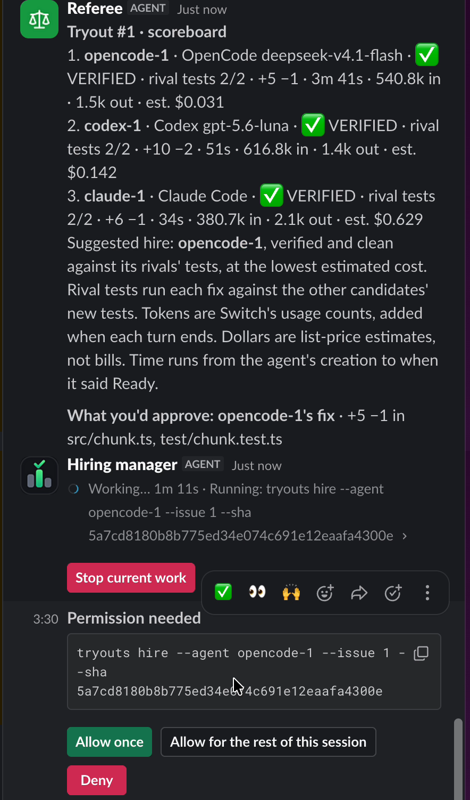
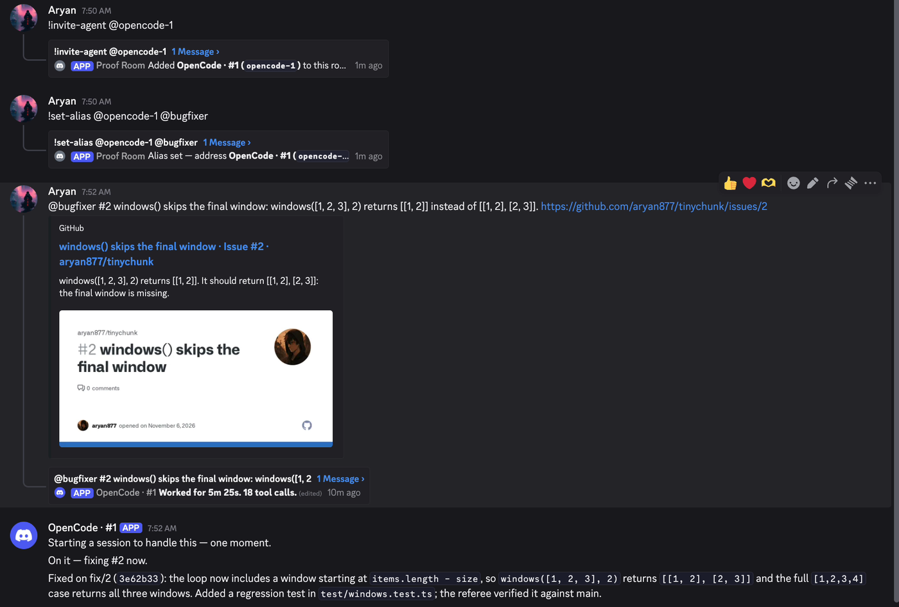
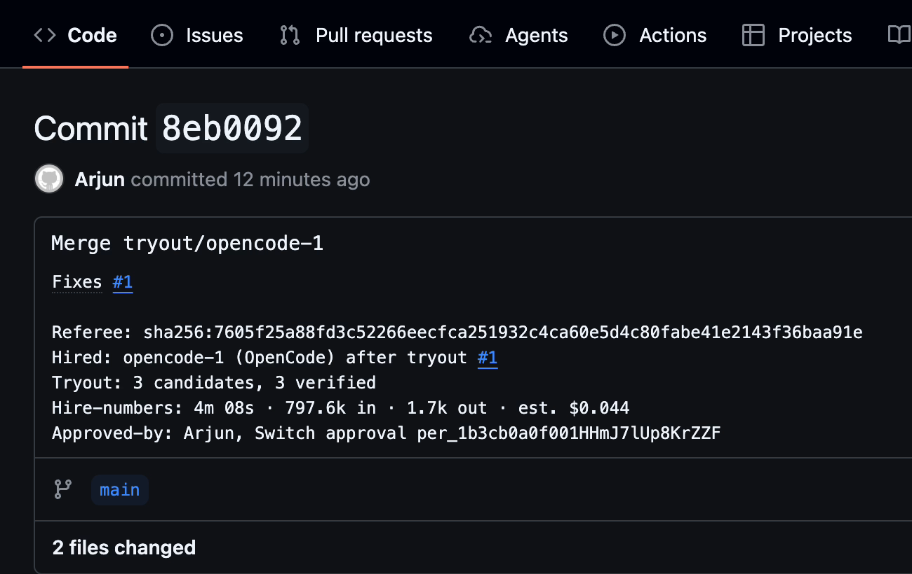
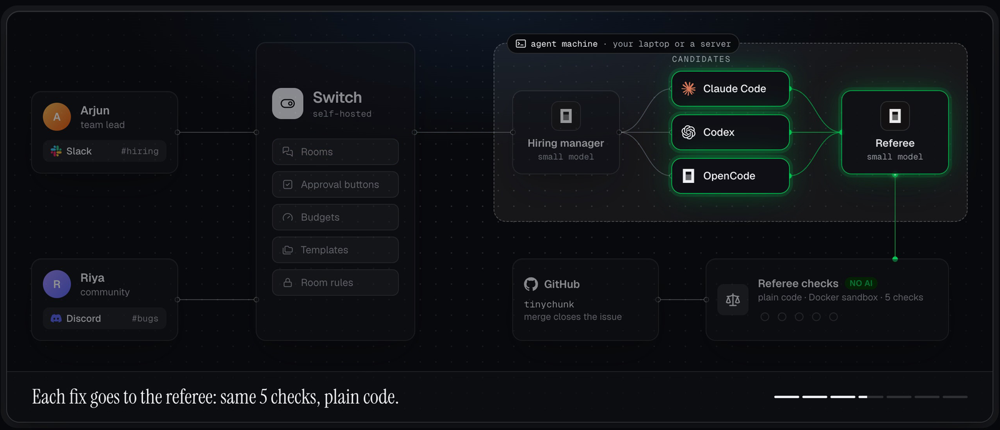

<div align="center">


# Tryouts

### Hire your AI coder like an employee.

Claude Code, Codex and OpenCode try out on the same real bug. Plain code checks every fix. The team
lead hires the winner with one **Allow once** button in **Slack**, and the community gives it work in
**Discord**. Built on [Switch](https://github.com/sandbox-quantum/switch).

<sub>Built on</sub><br>
<a href="https://www.switchagents.ai"></a>

[](https://tryouts.aryankumar.dev)
[](https://github.com/sandbox-quantum/switch)
[](https://www.wemakedevs.org/hackathons/switch)
[](#license)

**[Live site](https://tryouts.aryankumar.dev)** · **[Video](https://youtu.be/FUbMHSQCVYY)** · **[A real run](#a-real-run)** · **[Set it up](#set-it-up-once)** · **[Check it yourself](JUDGES.md)**

<a href="https://youtu.be/FUbMHSQCVYY"></a>

<picture>
  <source media="(prefers-color-scheme: dark)" srcset="docs/images/landing-dark.png">
  
</picture>

</div>

## Why

Teams pick an AI coding tool from a demo or a hunch, then live with it. Nobody tests the tools side by
side on their own code, with the same rules, and keeps the receipts.

Tryouts treats it like hiring a person: a tryout on a real bug, a fair check, a scoreboard, a human
who makes the call, and a probation period.

## A real run

This is the run in the video, on a real repo: [aryan877/tinychunk](https://github.com/aryan877/tinychunk),
issue #1, _"chunk() drops the last partial chunk"_.

| Candidate                 | Model                 | Referee     | Time   | Tokens in / out | Est. cost  |
| ------------------------- | --------------------- | ----------- | ------ | --------------- | ---------- |
| claude-1 · Claude Code    | Claude Code's default | ✅ verified | 21s    | 440.5k / 1.5k   | $0.449     |
| codex-1 · Codex           | gpt-5.6-luna          | ✅ verified | 43s    | 558.9k / 1.3k   | $0.141     |
| **opencode-1 · OpenCode** | deepseek-v4.1-flash   | ✅ verified | 4m 08s | 797.6k / 1.7k   | **$0.044** |

All three fixed it. OpenCode was hired: the same result for about a tenth of Claude Code's cost. Token
counts come from Switch's usage API; dollars are list-price estimates.

<table>
  <tr>
    <td width="42%" rowspan="2" valign="top">
      
      <br><b>1 · Slack.</b> The scoreboard, then the hire. The hiring manager can't hire on its own:
      Switch turns <code>tryouts hire</code> into a card only Arjun can answer.
    </td>
    <td width="58%" valign="top">
      
      <br><b>2 · Discord.</b> Riya lets the hire into her room, names it <code>@bugfixer</code> and
      reports bug #2. It answers her there once the referee has verified the fix.
    </td>
  </tr>
  <tr>
    <td valign="top">
      
      <br><b>3 · GitHub.</b> The merge is the receipt. It closes the issue and names the referee's
      digest, the hire and the Switch approval.
    </td>
  </tr>
</table>

Between steps 1 and 2, the hiring manager tried to add the hire to Riya's room itself. Switch said no,
because that room isn't Arjun's:

> Step 8: adding opencode-1 to the bugs room was refused by Switch: "403: Not authorized to change
> this room's membership".

The proof is public: [commit 8eb0092](https://github.com/aryan877/tinychunk/commit/8eb0092) closed
#1 and [commit e644971](https://github.com/aryan877/tinychunk/commit/e644971) closed #2, the hire's
first job on probation. `make judge` re-checks every verdict from [`evidence/`](evidence/tryout-1).

## How it works

| #   | Where         | What happens                                                                                                                                           |
| --- | ------------- | ------------------------------------------------------------------------------------------------------------------------------------------------------ |
| 1   | Slack         | The team lead posts a job: _"@hiring we need a bug fixer. Hold a tryout on #1 with Claude Code, Codex and OpenCode."_                                  |
| 2   | Switch        | The **hiring manager agent creates the three candidates itself**, each with its own private room.                                                      |
| 3   | Switch        | Each candidate gets a **token budget**. Each one writes a test and a fix.                                                                              |
| 4   | Referee       | Plain code runs the **same five checks** on every fix. The key one: the new test must fail without the fix. Then a scoreboard from **Switch usage**.   |
| 5   | Slack, GitHub | The hire is an **"Allow once" button only the team lead can press**. It merges the exact checked code on GitHub and closes the issue.                  |
| 6   | Discord       | The hire tries to join the community's #bugs. **Switch says no**: not the team lead's room. The community lets it in as `@bugfixer`. Probation 1 of 3. |

## How it's built



- **People stay in their chat apps.** The team lead works in Slack, the community in Discord. Nobody
  signs up for anything new.
- **Switch runs the rules.** It is self-hosted and owns the rooms, approval buttons, budgets,
  templates and room rules.
- **One agent machine does the work.** A laptop or a server runs the hiring manager, the candidates
  and the referee under one Switch agent controller.
- **The referee is an agent that can run three commands.** Its verdict comes from plain code in a
  Docker sandbox, not from a model.
- **GitHub only gets what was checked and approved.**

## Why Switch makes this possible

| Switch feature                         | What Tryouts uses it for                                                         | Without it                                     |
| -------------------------------------- | -------------------------------------------------------------------------------- | ---------------------------------------------- |
| Agents that create agents              | The hiring manager creates every candidate and its room from one message         | Set up three agents and three channels by hand |
| Templates with conditions, room groups | One template picks any mix of tools; the rooms are filed together as "Tryout #1" | A separate setup per mix of tools              |
| One controller, three AI tools         | Claude Code, Codex and OpenCode run on one machine, same rules                   | Three tools, three setups                      |
| Usage and budgets                      | Real token counts on the scoreboard; past its budget, an agent gets no messages  | Cost is a guess; nothing caps an agent         |
| Approval buttons                       | The hire and every merge wait for the owner's "Allow once"                       | A bot with merge rights, or copying commands   |
| Room ownership                         | The hire can't push itself into someone else's room                              | One bot can post anywhere                      |
| Aliases                                | The hire answers to `@bugfixer`                                                  | Renaming bots by hand                          |
| Owner-confirmed deletion               | Losing agents are deleted only when the owner confirms                           | Cleanup by hand, or agents deleting each other |
| Slack and Discord bridges              | The team hires in Slack; the community reports bugs in Discord                   | Two bots, two codebases                        |

## The referee

Every fix gets the same five checks. No AI decides who passes.

1. **Based on the latest main**, so what merges is exactly what was tested.
2. **Adds a regression test**, and deletes none.
3. **Stays in scope**: only the folders `referee.json` allows, and never git attributes.
4. **Tests pass with the fix**, including the original version of every test file it changed, so it
   can't weaken an old test.
5. **The new test fails without the fix.** That's how you know it really catches the bug.

Each run happens in a fresh Docker sandbox with no network. The result is a `sha256` digest that
anyone can recompute.

Each of these attacks has a test that builds it and shows the referee refusing it:

- deleting or weakening a test, or hiding one with `.gitattributes`;
- a "new test" that only fails because a file it imports is missing;
- editing `referee.json` from the branch;
- planting git hooks, or files that break a later run;
- renaming files into the allowed folders;
- tests that hang;
- a base taken from the contributor's fork instead of upstream;
- branch names that smuggle options or shell syntax.

The hire and every merge also check Switch's own record. Arjun must have pressed "Allow once" on the
hiring manager's card for that exact command, and each card works once.

## Set it up once

There is no sign-up for Tryouts. A team adds it to its own Switch, and Switch handles accounts, chat
connections and permissions. One person does this once:

1. Run Switch on your server and log in to Switch Console.
2. Connect your Slack and Discord in Switch Console.
3. On the machine that runs the agents: install Switch's agent controller, log in to Claude Code,
   Codex and OpenCode, and run `bun run setup https://github.com/your/repo`.
4. In Switch Console → Resources → Templates, upload `templates/tryout.yaml`, `bugs-room.yaml` and
   `tryouts-team.yaml`, then press **Use** on `tryouts-team`. `#hiring` appears in your Slack.

Your repo needs one small file, `referee.json`, telling the referee how to run your tests and which
folders a fix may touch:

```json
{ "test": ["npm", "test"], "scope": ["src/", "test/"], "sandbox": { "image": "node:22" } }
```

| Who           | What they do                                                         | New account? |
| ------------- | -------------------------------------------------------------------- | ------------ |
| Team lead     | Posts a job in Slack `#hiring`, presses "Allow once"                 | No           |
| Community     | Reports bugs in Discord `#bugs`                                      | No           |
| The AI agents | Appear by themselves; Switch keeps them in their rooms and in budget | —            |

## Check it yourself

- **Read the receipts.** The commits and closed issues on
  [aryan877/tinychunk](https://github.com/aryan877/tinychunk), and Switch's raw usage, budgets and
  transcripts in [`evidence/tryout-1`](evidence/tryout-1).
- **Replay the referee.** `make judge` re-runs every recorded check from `evidence/` without Switch
  (needs Bun and Docker) and expects the same digests.
- **Run the whole story.** `bun install && bun run demo up && bun run e2e` plays Arjun and Riya on a
  local Switch with Mattermost.

[JUDGES.md](JUDGES.md) maps every claim to a command and the line you should see.

<details>
<summary><b>Repo layout</b></summary>

```
templates/        The product: team, tryout and bugs-room templates for Switch
apps/cli          `tryouts verify|board|budget|hire|merge`, the only commands the agents run
packages/referee  The five checks and the merge, deterministic, no AI
packages/switch   Typed clients for the Switch gateway and Mattermost
apps/stack        `bun run demo`, `bun run e2e`, the recorder and `make judge`
apps/web          The landing page at tryouts.aryankumar.dev
kit/              Shared names and the record shape the recorder writes
examples/         tinychunk, published to github.com/aryan877/tinychunk by `bun run demo github`
evidence/         Raw Switch usage, budgets and transcripts, git bundles, referee reports
```

</details>

## Limits, said plainly

- Every candidate runs as the same OS user on one machine, so a determined candidate could read the
  team lead's Switch login from the `tryouts` config. Run candidates as another user to close that.
- Anyone in #bugs can type `!invite-agent`, and once the hire is in, address it.
- A budget stops new messages to an agent, not a turn it is already running.
- A test can pass all five checks while testing something other than the issue. That's why a person
  presses the button.
- Time on the scoreboard comes from the candidate's own commit, so a candidate could fake its speed.
- Token counts arrive when a turn ends; dollars are list-price estimates; one bug is a sample of one.

## License

Tryouts is MIT. Switch, its name and its logo belong to SandboxAQ; Switch is Apache-2.0 with Commons Clause;
`infra/switch/docker-compose.yml` is trimmed from Switch's standalone compose file. Built with Claude
Code and Codex as coding assistants.
